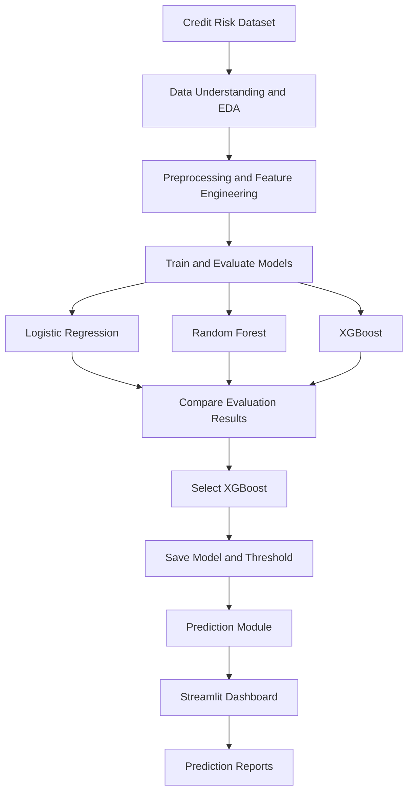

::: {align="center"}
``{=html}

# AI Credit Risk Prediction System

**An end-to-end machine learning project for estimating loan default
risk from borrower and loan information.**

[](https://www.python.org/)
[](https://scikit-learn.org/)
[](https://xgboost.readthedocs.io/)
[](https://streamlit.io/)
[](https://github.com/SumitSubham/AI-Credit-Risk-Prediction-System)

[](#-machine-learning-models)
[](#-limitations-and-disclaimer)

**[📂 View
Repository](https://github.com/SumitSubham/AI-Credit-Risk-Prediction-System)**
:::

------------------------------------------------------------------------

## 📖 Overview

Credit risk assessment helps lenders evaluate the possibility that a
borrower may default on a loan. This project builds a machine learning
workflow that uses borrower characteristics and loan attributes to
estimate default probability and provide a risk classification through
an interactive Streamlit dashboard.

The project includes exploratory data analysis, data preprocessing,
feature engineering, training and evaluation of multiple classification
algorithms, model selection, and a prediction interface.

**Three models are evaluated:** Logistic Regression, Random Forest, and
XGBoost. **XGBoost is the selected model for the current prediction
application**, based on the project's model evaluation results.

> **Important:** This is an educational and portfolio project, not a
> production-ready lending decision system.

## ✨ Key Features

  -----------------------------------------------------------------------
  Feature                             Description
  ----------------------------------- -----------------------------------
  📊 Exploratory Data Analysis        Examine data distributions, missing
                                      values, and target-class balance.

  🧹 Data Validation                  Validate required input fields,
                                      types, and acceptable ranges.

  ⚙️ Feature Engineering              Prepare borrower and loan
                                      attributes used by the prediction
                                      pipeline.

  🤖 Multi-Model Evaluation           Train and compare Logistic
                                      Regression, Random Forest, and
                                      XGBoost.

  🏆 Model Selection                  Use evaluation results to select
                                      XGBoost for the application.

  🎯 Default Probability              Estimate the probability of loan
                                      default for an entered application.

  🚦 Risk Classification              Produce a classification using the
                                      saved model threshold.

  🖥️ Interactive Dashboard            Explore a prediction through the
                                      Streamlit interface.

  📄 Report Export                    Export prediction reports in PDF,
                                      CSV, and JSON formats.

  💾 Model Persistence                Load the saved XGBoost model
                                      artifact using Joblib.
  -----------------------------------------------------------------------

## 🖼️ Application Preview

The project includes a Streamlit dashboard for entering borrower
information, reviewing prediction results, and exporting reports.

**Dashboard screenshot:** A screenshot can be added here once it has been saved in the repository (for example, `docs/images/dashboard.png`). No screenshot is currently embedded in this README.
## 🔄 Project Workflow



## 📂 Project Structure

``` text
AI-Credit-Risk-Prediction-System/
├── dashboard/
│   └── app.py
├── models/
│   └── credit_risk_xgboost.joblib
├── notebooks/
│   └── 01_Exploratory_Data_Analysis.ipynb
├── src/
│   └── predict.py
├── .gitignore
├── README.md
└── requirements.txt
```

*Confirm the exact notebook filename and paths in your local repository
before publishing.*

## 📊 Dataset

The project uses a credit risk dataset with borrower and loan-related
attributes.

  Detail               Description
  -------------------- ---------------------------------
  Target variable      `loan_status`
  Class `0`            No default
  Class `1`            Default
  Input features       11 borrower and loan attributes
  Known dataset size   32,581 records

Features include age, income, home ownership, employment length, loan
intent, loan grade, loan amount, interest rate, loan-to-income
proportion, previous default indicator, and credit history length.

The raw CSV is kept locally and may be excluded from GitHub by `.gitignore`.
If it is not present after cloning, obtain the authorized dataset and place
it at the path expected by the notebook before running the analysis. The
dataset is not assumed to be bundled with this repository.

## 🧠 Machine Learning Models

Three classification algorithms were implemented and evaluated.

  -----------------------------------------------------------------------
  Model                               Role in the project
  ----------------------------------- -----------------------------------
  **Logistic Regression**             Baseline classification model

  **Random Forest Classifier**        Tree-based ensemble model for
                                      learning nonlinear patterns

  **XGBoost Classifier**              Gradient-boosting model selected
                                      for the current application
  -----------------------------------------------------------------------

### Model Evaluation

The models should be compared using the evaluation results recorded in
the project notebook. Recommended metrics include:

-   **Accuracy:** Overall proportion of correct predictions.
-   **Precision:** Of applications predicted as defaults, the proportion
    that are actual defaults.
-   **Recall:** Of actual defaults, the proportion identified by the
    model.
-   **F1-score:** Harmonic mean of precision and recall.
-   **ROC-AUC:** Ability to distinguish default and non-default cases
    across classification thresholds.

### Model Comparison Results

| Model | Accuracy | Precision | Recall | F1-score | ROC-AUC |
|---|---:|---:|---:|---:|---:|
| Logistic Regression | Not verified | Not verified | Not verified | Not verified | Not verified |
| Random Forest | Not verified | Not verified | Not verified | 83.21% | 93.63% |
| XGBoost | Not verified | Not verified | Not verified | Not verified | Not verified |

**Verification note:** The Random Forest test F1-score (0.8321) and ROC-AUC (0.9363) are taken from the saved notebook outputs. The other metrics are left unreported until their exact values are verified. Do not interpret the Random Forest scores as XGBoost results.

### Final Model

**Selected model: XGBoost Classifier**

The application loads the saved model artifact, which contains the
trained model and its configured classification threshold. The
prediction module validates user inputs, derives required features,
estimates default probability, and returns the prediction and risk
classification.

## 🛠️ Technology Stack

-   **Programming:** Python
-   **Data analysis:** Pandas, NumPy
-   **Machine learning:** Scikit-learn, XGBoost
-   **Model persistence:** Joblib
-   **Dashboard:** Streamlit
-   **PDF reports:** ReportLab
-   **Development:** Jupyter Notebook, VS Code
-   **Version control:** Git and GitHub

## 🚀 Installation Guide

### Prerequisites

-   Python installed
-   Git installed
-   Access to any required dataset files
-   The saved model artifact available at the path expected by the app

### 1. Clone the repository

``` bash
git clone https://github.com/SumitSubham/AI-Credit-Risk-Prediction-System.git
cd AI-Credit-Risk-Prediction-System
```

### 2. Create and activate a virtual environment

For Windows PowerShell:

``` powershell
python -m venv venv
.\venv\Scripts\Activate.ps1
```

### 3. Install dependencies

``` bash
python -m pip install -r requirements.txt
```

### 4. Launch the Streamlit dashboard

``` bash
python -m streamlit run dashboard/app.py
```

Open the local URL displayed in the terminal to use the application.

> **Setup note:** If a required dataset or model file is excluded from
> Git, obtain it separately and place it at the expected path before
> running the relevant workflow.

## 📘 How to Use the Dashboard

1.  Launch the Streamlit app using the command above.
2.  Enter the required borrower and loan information.
3.  Run the prediction.
4.  Review the estimated default probability and resulting risk
    classification.
5.  Export the available report in PDF, CSV, or JSON format if required.

The displayed probability is a model estimate and is not a guarantee of
future repayment or default.

## 🔮 Future Improvements

-   Verify and document the remaining model evaluation metrics.
-   Add dashboard screenshots and a short demonstration GIF.
-   Evaluate probability calibration and tune the classification
    threshold.
-   Add model explainability, such as SHAP, if implemented and
    validated.
-   Add automated tests and continuous integration.
-   Deploy the dashboard to a suitable hosting platform.
-   Monitor data drift and model performance if the project is extended
    toward production.

## ⚠️ Limitations and Disclaimer

-   Model quality depends on the training data and how well it
    represents future applicants.
-   Class imbalance can affect the interpretation of accuracy.
-   False negatives and false positives have different consequences in
    credit risk.
-   Probability estimates may require calibration.
-   Fairness, explainability, privacy, security, and regulatory
    requirements must be addressed before real-world lending use.

**This project is intended for educational, research, and portfolio
demonstration purposes only. It must not be used as the sole basis for
real lending decisions.**

## 👨‍💻 Author

**Sumit Subham**

Data Analyst(Assistant Manager) --- City Union Bank Ltd., Bangalore
M.Tech --- Industrial Engineering and Management (Data Science), NIT Trichy

[GitHub Profile](https://github.com/SumitSubham) · [Project
Repository](https://github.com/SumitSubham/AI-Credit-Risk-Prediction-System)

------------------------------------------------------------------------

::: {align="center"}
If you find this project useful, feel free to explore the repository and
share feedback.

``{=html}
:::
