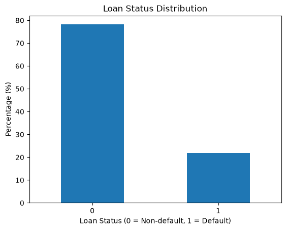
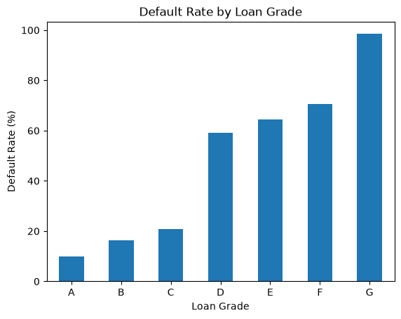
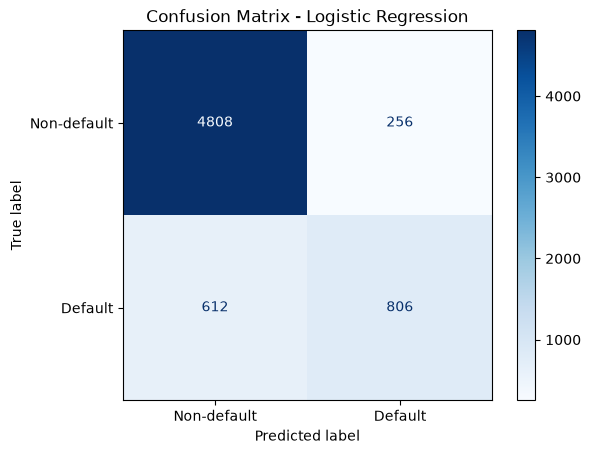
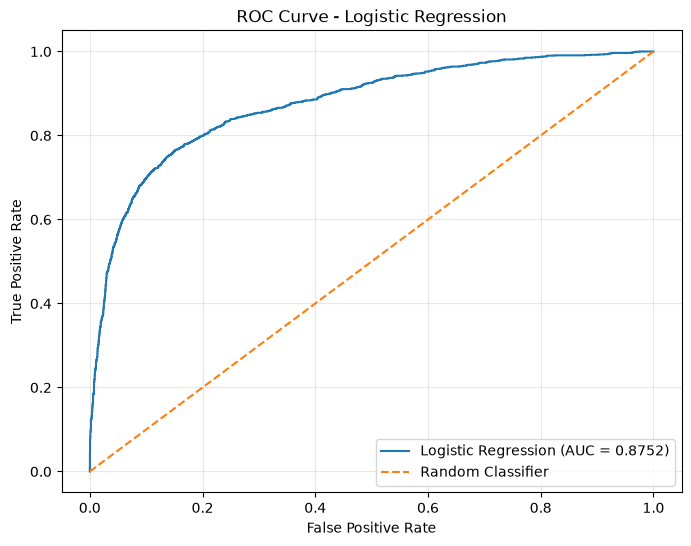
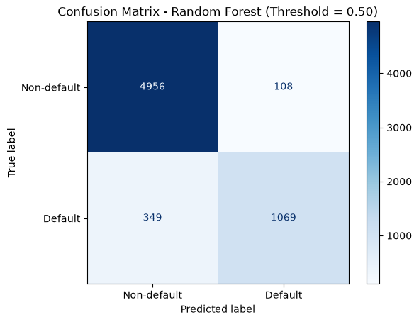
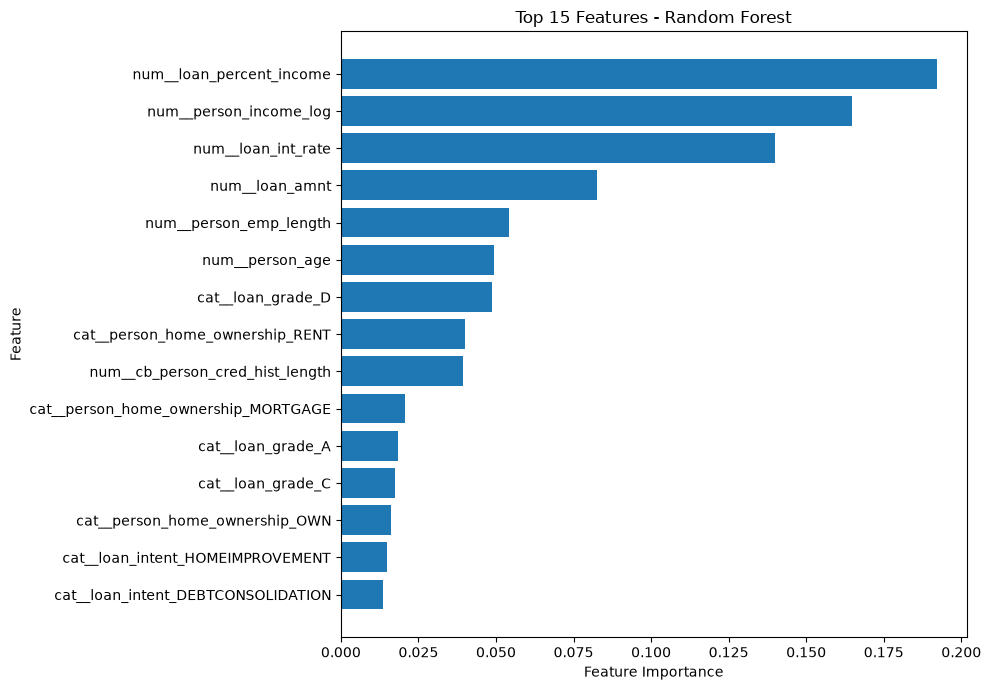
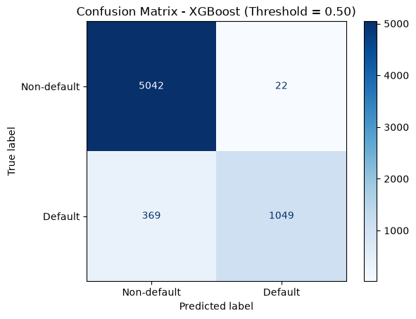
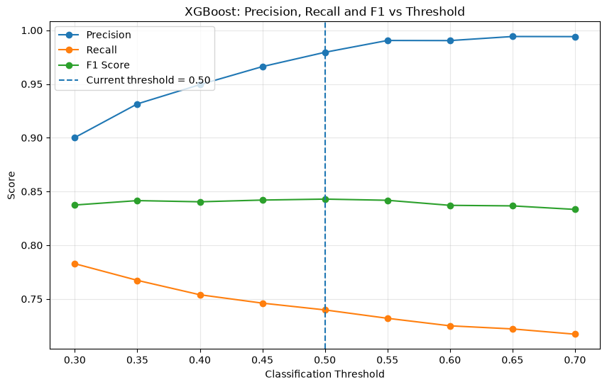
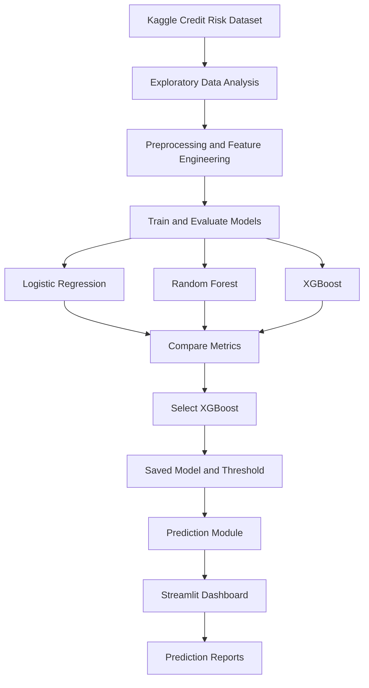

<div align="center">


# AI Credit Risk Prediction System

**An end-to-end machine learning project to estimate loan default risk using borrower and loan attributes.**

[](https://www.python.org/)
[](https://scikit-learn.org/)
[](https://xgboost.readthedocs.io/)
[](https://streamlit.io/)

[🚀 **Live Demo — Try the Credit Risk Prediction App**](https://ai-credit-risk-prediction-sumit.streamlit.app)

</div>

---

## Overview

This project explores credit risk using borrower and loan information, trains and evaluates classification models, and provides a Streamlit dashboard that estimates a loan applicant's default probability and assigns a risk classification.

The notebook evaluates **Logistic Regression, Random Forest, and XGBoost**. The dashboard currently uses the saved **XGBoost** model artifact.

> **Portfolio/educational project only.** Predictions are model estimates and must not be used as the sole basis for real lending decisions.

## Key Features

- Exploratory data analysis (EDA) with charts and target distribution analysis
- Data preprocessing and feature engineering
- Comparison of Logistic Regression, Random Forest, and XGBoost
- Classification metrics, ROC-AUC, confusion matrices, and threshold analysis
- Streamlit prediction dashboard with risk classification
- Exportable prediction reports in PDF, CSV, and JSON formats
- Saved model artifact loaded with Joblib

## Dataset

- **Source:** [Credit Risk Dataset — Kaggle, by laotse](https://www.kaggle.com/datasets/laotse/credit-risk-dataset/data)
- **Rows:** 32,581
- **Columns:** 12 (11 input features and the target)
- **Target:** `loan_status` (`0` = non-default, `1` = default)

The dataset contains borrower and loan attributes such as age, income, home ownership, employment length, loan intent, loan grade, loan amount, interest rate, loan-to-income ratio, previous default indicator, and credit history length.

Please consult the original Kaggle page for the current license and applicable usage terms.

## Exploratory Data Analysis

The notebook includes target-class distribution, default-rate comparisons, feature relationships, and correlation analysis.





## Model Evaluation

The following are the **recorded test-set results in the uploaded notebook**. Logistic Regression and XGBoost use a 0.50 classification threshold; Random Forest uses a 0.60 threshold. ROC-AUC is calculated from predicted probabilities and does not depend on the classification threshold.

| Model / threshold | Accuracy | Precision | Recall | F1-score | ROC-AUC |
|---|---:|---:|---:|---:|---:|
| Logistic Regression (0.50) | 86.61% | 75.89% | 56.84% | 65.00% | 87.52% |
| Random Forest (0.60) | 93.52% | 96.03% | 73.41% | 83.21% | 93.63% |
| XGBoost (0.50) | 93.97% | 97.95% | 73.98% | 84.29% | 95.10% |

**Selected application model: XGBoost.** It has the highest recorded accuracy, F1-score, and ROC-AUC in this comparison. Metric values are dependent on the dataset split, preprocessing, and evaluation setup; they should not be interpreted as evidence of production readiness.

### Confusion Matrices and Evaluation Graphs

**Logistic Regression**





**Random Forest**





**XGBoost**





## Project Workflow



## Project Structure

```text
AI-Credit-Risk-Prediction-System/
├── dashboard/
│   └── app.py
├── data/
│   └── raw/
│       └── credit_risk_dataset.csv
├── docs/
│   └── images/
├── models/
│   └── credit_risk_xgboost.joblib
├── notebooks/
│   └── 01_Exploratory_Data_Analysis.ipynb
├── src/
│   └── predict.py
├── README.md
└── requirements.txt
```

The Random Forest artifact is used in notebook evaluation and may be large. It is not required to run the dashboard if the app loads only the XGBoost artifact. Confirm that any model file required by the application is included or otherwise made available before deployment.

## Run Locally

### 1. Clone the repository

```powershell
git clone https://github.com/SumitSubham/AI-Credit-Risk-Prediction-System.git
cd AI-Credit-Risk-Prediction-System
```

### 2. Create and activate a virtual environment (Windows PowerShell)

```powershell
python -m venv venv
.\venv\Scripts\Activate.ps1
```

### 3. Install dependencies

```powershell
python -m pip install -r requirements.txt
```

### 4. Start the dashboard

```powershell
python -m streamlit run dashboard/app.py
```

Open the local URL printed in the terminal. The public demo is available on [Streamlit Community Cloud](https://ai-credit-risk-prediction-sumit.streamlit.app).

## How to Use the Dashboard

1. Start the Streamlit app.
2. Enter the requested borrower and loan details.
3. Run the prediction.
4. Review the estimated default probability and risk classification.
5. Download the available PDF, CSV, or JSON report.

## Technology Stack

- **Language:** Python
- **Data analysis:** Pandas, NumPy
- **Machine learning:** Scikit-learn, XGBoost
- **Model persistence:** Joblib
- **Dashboard:** Streamlit
- **Reports:** ReportLab and dashboard export utilities
- **Development and version control:** Jupyter Notebook, VS Code, Git, GitHub

## Limitations and Disclaimer

- Results depend on the dataset and the train/test split used in the notebook.
- Class imbalance means accuracy alone is not sufficient for model evaluation.
- Threshold choice changes the precision/recall trade-off.
- Probability calibration, fairness, explainability, privacy, security, and regulatory requirements would need further work before any real-world lending use.
- This project is for educational and portfolio demonstration only and is not a production credit-decision system.

## About the Author

**Sumit Subham**  
Data Analyst | City Union Bank Ltd., Bengaluru, India  
M.Tech in Industrial Engineering & Management (Data Science) — NIT Tiruchirappalli

[GitHub](https://github.com/SumitSubham) · [LinkedIn](https://www.linkedin.com/in/sumit-subham-42081025a/)

---

## License

This project is intended for educational and portfolio purposes only. All rights reserved. No license is granted for reuse or redistribution.

---

*If you find this project useful, feel free to explore the repository and share feedback.*
